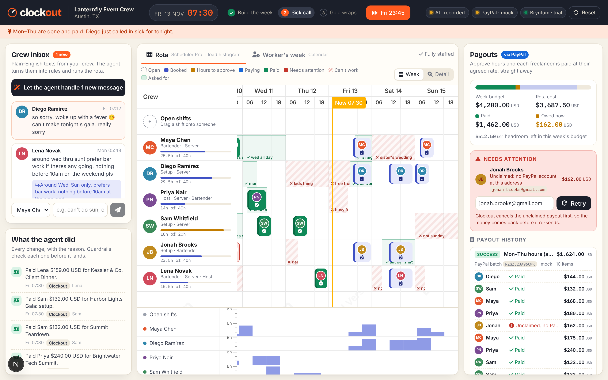

# Clockout

**Rotas that run themselves. Crews paid at clock-out.**



Small businesses that run crews of freelancers (event staffing agencies, cleaning contractors, film and production crews) lose their Sunday nights rebuilding the rota in a spreadsheet, and their crews wait two weeks or more for invoices to clear. Clockout fixes both ends of the week. Workers text availability and changes in plain English ("can't do Sat, can take Tues eve"). An AI agent turns those texts into scheduling rules and runs the rota itself on a Bryntum Scheduler: it builds the week within budget, refills a sick call with the best available person in seconds, and explains every change. When a shift ends and the owner approves the hours, Clockout pays each worker straight away with **PayPal Payouts**, at their agreed rate with night and weekend rates, and the shift's bar on the schedule turns from *booked* to *paid*.

**Why Payouts and not payroll?** The crew are independent contractors, not employees. They're self-employed freelancers who invoice per shift. PayPal positions Payouts for exactly this: paying many recipients at once, such as gig workers and freelancers. There's no payroll run to wait for. Approve hours, and the money moves.

---

## Judge quickstart

**Demo video (2 min, live Gemini and PayPal sandbox):** https://youtu.be/_yPhB6Wesl8

**Hosted demo:** `https://clockout.onrender.com` *(placeholder: replace with the deployed URL)*
The free Render instance sleeps when idle. **The first load can take about a minute to wake up**; after that it's instant.

**Run it locally in mock mode (no API keys needed)** with Node 20+. Bryntum's trial packages come from Bryntum's own npm registry, so the only thing you need is the email you registered a [Bryntum trial](https://bryntum.com/download/) with:

```bash
BRYNTUM_EMAIL=you@example.com bash scripts/bryntum-auth.sh && npm install && npm run dev:mock
```

Open http://localhost:3000. `npm run dev` also works with no keys at all: every external service falls back to its mock automatically, and the chips in the top bar say which mode each one is in.

### The three-minute story

| Step | Click | What happens |
| --- | --- | --- |
| **Mon 06:00** | **Let the agent handle 6 new messages** | Gemini reads six messy texts into constraints (hatched red = can't work, green = asked for). Then it assigns all 18 shifts within the $4,200 budget, one sentence of reasoning per pick. Guardrails re-check every assignment. |
| **Fri 07:30** | **Jump** (top bar) | The jump fast-forwards Mon–Thu: those hours are auto-approved (a demo shortcut) and paid in one PayPal batch. In mock mode, Jonah's payout comes back **UNCLAIMED** (typo: `gmial.com`). Fix the email and hit **Retry**. Diego texts in sick. Click **Let the agent handle 1 new message**: he's taken off tonight's gala and the best free, qualified, under-cap person is booked in seconds. |
| **Fri 23:45** | **Jump**, then **Approve & pay 3 with PayPal** | The gala crew's bars stripe blue (*paying*), then turn green (*paid*). The payouts panel reconciles to **Nothing owed**. |

**Reset** in the top bar puts everything back to Monday morning.

### Real vs simulated

Tested on 4–5 and 12 Nov 2026, against the real Gemini API and the real PayPal sandbox:

| | Mock mode (no keys) | Live: Gemini + PayPal sandbox |
| --- | --- | --- |
| AI reads messages, builds the week, refills the sick call | ✅ Recorded tool-call answers plus a small rule-based reader | ✅ Ran end to end on Gemini. On 12 Nov 2026 the newest Flash (`gemini-3.8-flash`) was overloaded, so `gemini-2.5-flash` built the week, and the chip showed that model. Later in the same run both models were busy for the sick call, so recorded answers covered it and the chip read *AI · recorded*. When no model answers, Clockout uses recorded answers and the chip reads *AI · recorded*. In the demo video, `gemini-3.5-flash-lite` (set with `AI_MODEL`) answered all three calls live. |
| Create a Payouts batch, poll it, update the bars | ✅ | ✅ Real batches created and settled (e.g. `ADNYV94GX85FA`, `7PPYELRHTJUFJ`). |
| Payouts end as **SUCCESS** (bars turn green, "Nothing owed") | ✅ | ✅ **Verified on 5 Nov 2026** with a funded sandbox business app and a sandbox personal account as the receiver. Mon–Thu batch `S3M64ZEMNW34C`: 9 items `SUCCESS` and Jonah's typo `UNCLAIMED`, as designed. Gala batch `Y6UEARDQGLTMU` also went out. **Re-verified on 12 Nov 2026** with `SANDBOX_RECEIVER_SAM` and `SANDBOX_RECEIVER_AVA`: batch `N5GQYNM6MFNAA` paid 9 items `SUCCESS` across the two accounts, and gala batch `E29DWBXLDCG7U` paid 2 `SUCCESS`. In that run Jonah's two payouts stayed `UNCLAIMED` (his typo'd email). Live mode now pays Jonah through the sandbox receivers too, and a second run the same day (batches `AHW4A9GP6PZUS` and `MQK9FU2KSHXXU`) ended with all 13 items `SUCCESS` and nothing owed. Gemini's free quota was spent by then, so that second run used recorded AI answers. Without a personal receiver, payouts come back `UNCLAIMED`; with the app's own account as receiver, they fail with `SELF_PAY_NOT_ALLOWED`. |
| PayPal refuses the whole batch (e.g. `INSUFFICIENT_FUNDS`) | ✅ (tested) | ✅ Seen live on 5 Nov 2026. Nothing is sent, the shifts return to "hours to approve", and the toast says to add sandbox funds and approve again. |
| Unclaimed payout: cancel, then re-send | ✅ | ❌ The sandbox's cancel endpoint returned `INTERNAL_SERVICE_ERROR` every time. Clockout then refuses to re-send, because re-sending before the cancel succeeds could pay twice, and shows why. A `FAILED` item (nothing to cancel) re-sends normally. |

**Simulated in both modes:**
- **The demo clock.** Time moves by button, not by the real clock.
- **The Mon–Thu fast-forward** auto-approves those hours. In real use the owner approves each shift.
- **Crew messages are seeded or typed into the composer.** No real SMS or WhatsApp is connected.
- **The crew and businesses** are fictional.

---

## How PayPal is used

All PayPal calls are server-side, in [`src/lib/paypal`](src/lib/paypal), behind one `PayoutsAdapter` interface with a live and a mock implementation.

| Moment in the app | PayPal API | Code |
| --- | --- | --- |
| Get an access token | OAuth2 client credentials via the official **`@paypal/paypal-server-sdk`** (`Client`, `clientCredentialsAuthManager.fetchToken()`) | `paypal/live.ts` |
| Owner clicks **Approve & pay** | `POST /v1/payments/payouts`: one batch, one item per shift, amounts from integer minor units. `sender_batch_id` is unique per send, so a double-click can't pay twice. | `payouts.ts → sendBatch` |
| Bars go *paying → paid* | `GET /v1/payments/payouts/{payout_batch_id}`, polled every 1.5s while items are `PENDING`. Each item's `transaction_status` drives the shift's state machine. | `payouts.ts → refreshPayouts` |
| A payout fails or goes unclaimed | Shown with PayPal's error (`RECEIVER_UNREGISTERED`, `SELF_PAY_NOT_ALLOWED`, …) in plain English. **Retry**: `POST /v1/payments/payouts-item/{id}/cancel` for `UNCLAIMED` items first (so money can't go out twice), then a new batch. The sandbox's cancel endpoint failed in testing (see the status table above). | `payouts.ts → retryPayout` |
| Payouts panel history | Every batch and item with PayPal's batch id, transaction id and status, reconciled against the weekly budget: paid, in flight, owed now, headroom. | `components/PayoutsPanel.tsx` |

The server SDK has no Payouts controller yet, so Payouts v1 is called over REST with the SDK-issued token. The mock ([`paypal/mock.ts`](src/lib/paypal/mock.ts)) keeps its state in SQLite and returns the documented response shapes: batches start `PENDING`, settle about 2 seconds later, and an address with no PayPal account comes back `UNCLAIMED` with `RECEIVER_UNREGISTERED`, just as the real sandbox does.

Currency defaults to **USD** for sandbox safety and is configurable (`CLOCKOUT_CURRENCY`). Money is integer minor units end to end, converted to PayPal's decimal strings without floating point, and the currency code is always shown.

## How AI is used

Two Gemini tool calls (Vercel AI SDK + `@ai-sdk/google`), each forced with `toolChoice` and validated with zod. No free-text parsing anywhere ([`src/lib/ai/schemas.ts`](src/lib/ai/schemas.ts)).

1. **`record_constraints`** turns every unread message into hard and soft rules: `unavailable` windows, `preferred` windows, preferred roles, an hour cap, and `dropShiftIds` (shifts the sender can no longer do, e.g. a sick call or a swap away). Times are resolved against the real week ("sat", "tues eve", "tonight").
2. **`assign_shifts`** gets each open shift's eligible candidates (cost, hours so far, what they asked for) plus the budget and a deterministic baseline. It returns one assignment per shift, each with a one-sentence reason for the owner.

**The model proposes; the code decides.** Every assignment is re-checked against the same hard rules as a drag and drop: role, unavailability, clashes, hour caps and budget ([`scheduling.ts`](src/lib/scheduling.ts)). A rejected pick is logged as *Guardrail*, and the slot is filled legally by the deterministic planner.

Swap requests are handled as **drop + refill**. "Can't do Thu, I'll take a Sat bar shift" drops the Thursday shift, refills it, and records the Saturday preference, which counts the next time open shifts are filled. There is no two-person trade, and Clockout won't move someone who is already booked to make room.

**Free-tier engineering** ([`src/lib/ai/index.ts`](src/lib/ai/index.ts)):

- **Model:** the newest stable Gemini Flash the API lists (or `AI_MODEL` if set), then the next two Flash models the API lists, then recorded responses. Clockout moves down that chain when a model is rate-limited (429), overloaded (503) or times out.
- **Cache:** responses are cached in SQLite by request hash, and the cache survives **Reset**, so re-running the demo costs no quota.
- **Rate limit:** calls are capped locally per minute.
- **Shown on screen:** the AI chip names what answered the last call: the model id (for example *AI · gemini-2.5-flash*), *Gemini (cached answer)*, or *recorded*, with the reason on hover. The agent log tags every action *Gemini*, *Recorded AI*, *Guardrail* or *You*.

## Bryntum depth

Clockout uses the **thin** trial packages, so **Scheduler Pro and Calendar run on the same page** with one shared core:

- **Scheduler Pro** rota, one row per worker plus an *Open shifts* row.
  - Drag, drop and resize, with a `validatorFn` that runs the same hard rules as the server and explains a refusal while you drag ("Maya is unavailable all day Sat (sister's wedding)").
  - A resize re-prices the shift at the agreed night and weekend rates.
  - A shift can't be stretched past 14 hours. This also stops a resize from running across the folded-out night hours.
- **Custom event renderer:** the bar's colour is its pay status (*open → booked → hours to approve → paying (animated stripes) → paid → needs attention*). Each bar shows role, time and pay. At week zoom it collapses to the worker's avatar and a status icon.
- **Rich tooltip:** the base, night and weekend split, plus the PayPal batch and transaction ids.
- **Resource time ranges** draw each worker's unavailability (hatched) and requested windows (green), straight from their texts.
- **Time ranges** show the demo clock's *Now* line, and the view follows it.
- **Non-continuous time axis** (`timeAxis.include` 06:00–24:00) folds out the night hours no one works.
- **Partnered Resource Histogram** under the Scheduler, sharing its project and time axis. It shows each worker's load live as shifts move. The resource column carries an hours-vs-cap bar. Honestly, this view adds less than the rest: the hard rules already block double-booking, so the histogram mostly confirms the rota is even.
- **Event menu:** right-click a booked shift and choose **Drop & let the agent find cover**. The dropped worker is recorded as unavailable for that slot, so the agent can't book them straight back in. If no one else qualifies, the shift is left open and the log says so.
- **Bryntum Calendar** (*Worker's week* tab): each worker's own week as they'd see it, with their shifts, pay status and blocked-out times, next to their agreed rates and what they've been paid so far.

## Live sandbox keys

Copy `.env.example` to `.env.local` and fill in what you have. Each service goes live independently when its key works:

```bash
cp .env.example .env.local
```

- **PayPal**
  1. In the [developer dashboard](https://developer.paypal.com/dashboard/applications/sandbox), create a sandbox REST app with **Payouts** enabled.
  2. Set `PAYPAL_CLIENT_ID` and `PAYPAL_CLIENT_SECRET`.
  3. Set receivers to sandbox **personal** accounts (*Testing Tools → Sandbox Accounts*). `SANDBOX_RECEIVER_<FIRSTNAME>` pays that worker, so `SANDBOX_RECEIVER_SAM` pays Sam. Every other worker is spread across the `SANDBOX_RECEIVER_*` accounts you set. `PAYPAL_SANDBOX_RECEIVER_EMAIL` is used only when no `SANDBOX_RECEIVER_*` is set. With none set, payouts go to the seeded workers' fictional emails, and PayPal holds them as `UNCLAIMED`.
  4. Don't use your business account as the receiver: PayPal rejects paying yourself (`SELF_PAY_NOT_ALLOWED`).
- **Gemini:** set `GOOGLE_GENERATIVE_AI_API_KEY` from [Google AI Studio](https://aistudio.google.com/apikey). Leave `AI_MODEL` empty to auto-pick.
- **Bryntum:** `BRYNTUM_EMAIL` is only needed to install packages, not at runtime.

## Deploying to Render

[`render.yaml`](render.yaml) defines one free web service. In Render, choose **New → Blueprint**, point it at this repo, and set the secret env vars it asks for (at minimum `BRYNTUM_EMAIL`). The build runs the same three steps as a local install:

```bash
bash scripts/bryntum-auth.sh && npm ci && npm run build
```

`scripts/bryntum-auth.sh` writes `@bryntum:registry=https://npm.bryntum.com` and a legacy-auth login to `~/.npmrc` on the build machine, never to the repo. The username is your email with `@` replaced by `..`, and the password is `trial`. The packages are installed through npm aliases (for example `"@bryntum/schedulerpro-thin": "npm:@bryntum/schedulerpro-thin-trial@7.3.8"`), so a licensed build is a one-line change per package. SQLite lives on the instance's disk and is re-seeded on boot.

## Under the hood

- **Next.js 16 (App Router) + TypeScript**, one Node service. Bryntum renders client-side only (`dynamic(..., { ssr: false })`).
- **SQLite** via `better-sqlite3`, seeded on boot with a deterministic, fictional scenario.
- **State machines:**
  - Shifts move `open → booked → completed → approved → paying → paid | failed → paying` ([`shiftState.ts`](src/lib/shiftState.ts)). An illegal move, such as paying an open shift or editing a paid one, throws.
  - PayPal item statuses map to *in flight*, *paid* or *needs attention* ([`payoutState.ts`](src/lib/payoutState.ts)).
- **Money** ([`money.ts`](src/lib/money.ts)): per-minute rate bands (base, night 22:00–06:00, weekend, with the higher of night and weekend winning), summed in integers and rounded once, half up.
- **Tests (Vitest):** money maths, both state machines, AI tool schemas and recorded responses, the hard rules and planner, and the entire demo story end to end in mock mode.

```bash
npm run check   # lint + typecheck + tests + production build
```

```
src/
  app/              Next.js pages and API routes (state, agent, shifts, payouts, demo clock)
  components/       Dashboard, Bryntum Scheduler Pro + Histogram, Calendar, inbox, payouts panel
  lib/
    ai/             Gemini adapter (cache, rate limit, model cascade, fallback), zod schemas, recordings
    paypal/         Payouts adapter: live (server SDK OAuth + REST) and mock
    agent.ts        read messages → constraints; fill open shifts; guardrails
    payouts.ts      approve → batch → poll → paid/failed → retry
    scheduling.ts   hard rules, candidate scoring, baseline planner
tests/              Vitest
```

See [docs/ARCHITECTURE.md](docs/ARCHITECTURE.md) for the five files that matter most, [DECISIONS.md](DECISIONS.md) for the trade-offs and [SUBMISSION.md](SUBMISSION.md) for the Devpost write-up.

## License

[MIT](LICENSE). Bryntum trial packages are under Bryntum's own trial licence and are not part of this repository.
